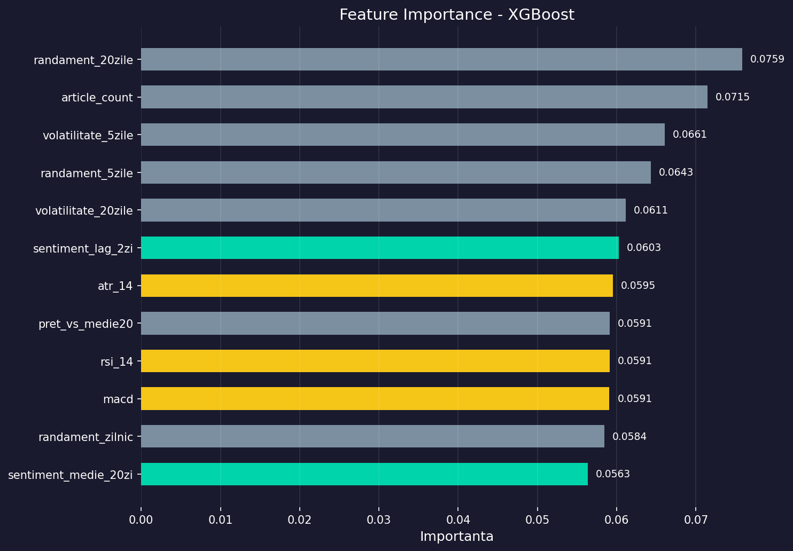
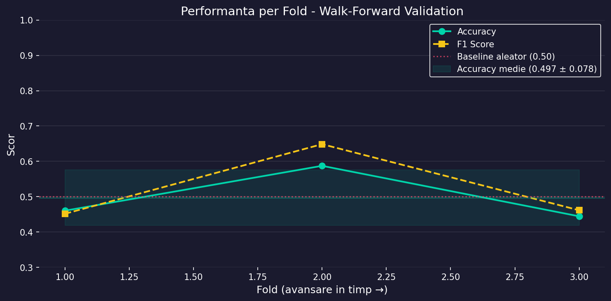
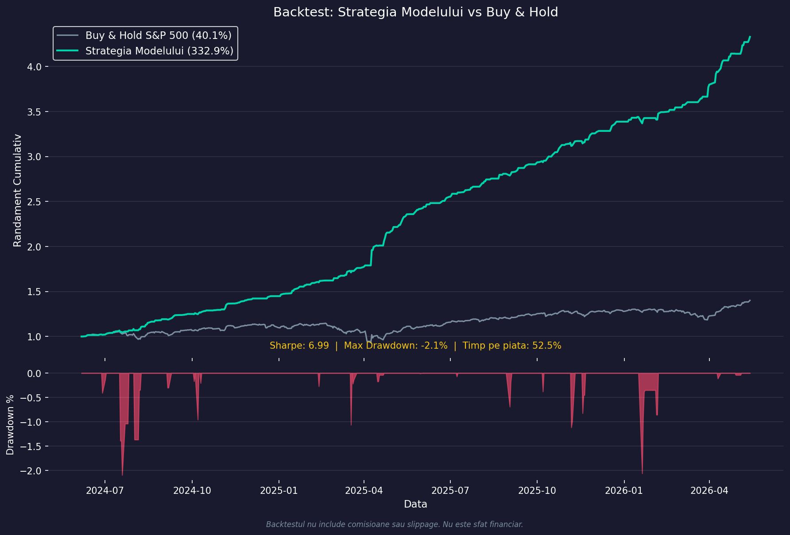

# S&P 500 Sentiment Trading | FinBERT + XGBoost

A Python machine-learning pipeline that combines **financial news sentiment** with **market indicators** to predict the next trading day's direction of the S&P 500 index. The project uses **FinBERT** for financial-language sentiment analysis and **XGBoost** for binary classification, with walk-forward evaluation and a simple trading-strategy backtest.

> **Core question:** Given recent market movements and today's financial headlines, is the S&P 500 more likely to close higher or lower on the next trading day?

## Overview

Price-based prediction projects typically rely only on historical returns and technical indicators. This experiment adds a separate information source: **the tone of financial news headlines**.

It investigates whether market indicators and sentiment-derived features can be combined in a time-aware classification workflow. The results are research-oriented, **not a reliable forecast or trading recommendation**.

## End-to-End Pipeline

```text
S&P 500 prices (^GSPC)       Financial news RSS
           |                        |
           v                        v
     OHLCV dataset             FinBERT inference
           |                        |
           |                  Daily sentiment
           |                        |
           +-----------+------------+
                       |
                       v
                Feature Engineering
                       |
                       v
             XGBoost Classification
                       |
                       v
           Walk-Forward Validation
                       |
                       v
           Reports + Trading Backtest
```

## Repository Structure

```text
SP500_Sentiment_Trading/
├── src/
│   ├── 1_collect_data.py           # Prices and financial headlines
│   ├── 2_sentiment_analysis.py     # FinBERT sentiment inference
│   ├── 3_feature_engineering.py    # Market and sentiment predictors
│   ├── 4_train_model.py            # XGBoost + walk-forward validation
│   ├── 5_evaluate.py               # Metrics, charts, strategy backtest
│   └── collect_data.py             # Additional data-collection script
├── data/
│   ├── raw/
│   │   ├── prices_raw.csv
│   │   └── news_raw.csv
│   └── processed/
│       ├── news_with_sentiment.csv
│       ├── sentiment_daily.csv
│       ├── features.csv
│       ├── predictions.csv
│       ├── walk_forward_results.csv
│       ├── feature_importance.csv
│       └── backtest_data.csv
├── models/
│   ├── xgb_classifier.pkl          # Trained classifier
│   └── feature_cols.pkl            # Saved feature ordering
├── reports/
│   ├── confusion_matrix.png
│   ├── feature_importance.png
│   ├── fold_performance.png
│   └── backtest_returns.png
├── run_all.py                      # Run all five stages
├── requirements.txt
└── README.md
```

## How Each Stage Works

### 1. Collect market data and financial news

`src/1_collect_data.py` uses `yfinance` to request approximately two years of daily S&P 500 prices (ticker `^GSPC`) and `feedparser` to read financial-news RSS feeds (including sources configured for Reuters, CNBC, MarketWatch, and Yahoo Finance).

Outputs: `data/raw/prices_raw.csv` and `data/raw/news_raw.csv`.

**Data limitation:** RSS feeds commonly expose only recent articles, not two years of historical news. Live feeds can change, become unavailable, or provide incomplete coverage. Historical price and news coverage therefore need to be checked before drawing conclusions about model performance.

### 2. Analyze sentiment with FinBERT

`src/2_sentiment_analysis.py` loads `ProsusAI/finbert` from Hugging Face and evaluates headlines in batches. The model assigns probabilities to **positive**, **negative**, and **neutral** sentiment. The script aggregates headline-level results into daily sentiment indicators.

Why FinBERT? A finance-adapted language model can handle domain terms such as *earnings miss* or *guidance cut* better than a generic keyword-based lexicon.

Outputs: `data/processed/news_with_sentiment.csv` and `data/processed/sentiment_daily.csv`.

### 3. Engineer prediction features

`src/3_feature_engineering.py` merges daily market information with sentiment and produces numerical predictors.

| Feature group | Examples | Motivation |
|---|---|---|
| Returns | Daily, 5-day and 20-day returns | Recent price movement |
| Momentum | RSI (14), MACD | Trend and overbought/oversold indicators |
| Volatility | Rolling volatility, ATR (14) | Market variability |
| Price / volume | Relative volume, close vs. moving average | Trading activity and trend |
| Sentiment | FinBERT score, lagged scores, rolling averages | Current and recent news tone |
| News activity | Number of articles | Coverage intensity |

The binary target is based on whether the next trading day's closing price is higher (`1`) or not (`0`).

Output: `data/processed/features.csv`.

### 4. Train and validate XGBoost

`src/4_train_model.py` uses an XGBoost classifier, tests six predefined hyperparameter combinations, considers class imbalance with `scale_pos_weight`, and evaluates sequentially using expanding-window **walk-forward validation**.

A simplified illustration:

```text
Fold 1: Train [days 1..252]   -> Test [days 253..315]
Fold 2: Train [days 1..315]   -> Test [days 316..378]
Fold 3: Train [days 1..378]   -> Test [days 379..441]
```

The temporal split matters: random shuffling can leak future patterns into the training set and lead to unrealistic estimates of performance.

Outputs include a trained model and predictions/feature-importance tables under `models/` and `data/processed/`.

### 5. Evaluate and backtest

`src/5_evaluate.py` generates classification and strategy visualizations:

| Report | What it shows |
|---|---|
| `confusion_matrix.png` | Correct and incorrect direction predictions |
| `feature_importance.png` | Relative importance of model inputs |
| `fold_performance.png` | Classification metrics across temporal folds |
| `backtest_returns.png` | Simulated model signals versus a buy-and-hold baseline |

Backtests are simplified simulations and may not include all realistic trading costs or constraints.

## Example Visualizations

**Feature importance**



**Walk-forward performance**



**Strategy comparison**



## Technology Stack

| Category | Library | Role |
|---|---|---|
| Market data | `yfinance` | Download S&P 500 historical prices |
| News | `feedparser` | Read RSS feeds |
| NLP | Hugging Face `transformers`, FinBERT | Financial headline sentiment |
| Deep learning runtime | PyTorch | Run FinBERT inference |
| Tabular ML | XGBoost | Binary market-direction classification |
| Data processing | Pandas, NumPy | Feature engineering |
| Evaluation | scikit-learn | Accuracy, F1, confusion matrix |
| Visualization | Matplotlib, Seaborn | Plots and reports |

## Getting Started

### 1. Clone and install dependencies

```bash
git clone https://github.com/Darius-Cos/SP500_Sentiment_Trading.git
cd SP500_Sentiment_Trading
python -m venv .venv
# Windows PowerShell:
.venv\Scripts\Activate.ps1
pip install -r requirements.txt
```

The first sentiment run downloads FinBERT model files. On some macOS installations, XGBoost may require OpenMP (`brew install libomp`).

### 2. Run the complete workflow

```bash
python run_all.py
```

Or run one stage at a time:

```bash
python src/1_collect_data.py
python src/2_sentiment_analysis.py
python src/3_feature_engineering.py
python src/4_train_model.py
python src/5_evaluate.py
```

### 3. Review generated results

The numerical results are saved under `data/processed/`, trained artifacts under `models/`, and plots under `reports/`.

> **Reproducibility note:** re-running data collection on a different date produces a different observation window; news feeds and upstream APIs may also differ. Use a fixed, dated dataset for comparable experimental results.

## Concepts Demonstrated

- Applying a pretrained NLP model to a specialized financial domain.
- Combining text-derived sentiment with numerical time-series features.
- RSI, ATR, MACD, and moving-window statistics.
- Class imbalance and hyperparameter search in gradient-boosted trees.
- Walk-forward evaluation and the prevention of look-ahead bias.
- Comparing classification quality with a simple strategy simulation.

## Limitations and Responsible Use

- News data availability and publication timing can bias the dataset.
- Historical price features must use only information available at prediction time.
- Observed feature importance is not proof of causal predictive power.
- Financial markets are noisy and non-stationary; an apparent backtest edge may disappear out of sample.
- The project is educational and does **not** provide financial or investment advice.

## Author

**Darius Costache** · [GitHub](https://github.com/Darius-Cos)
